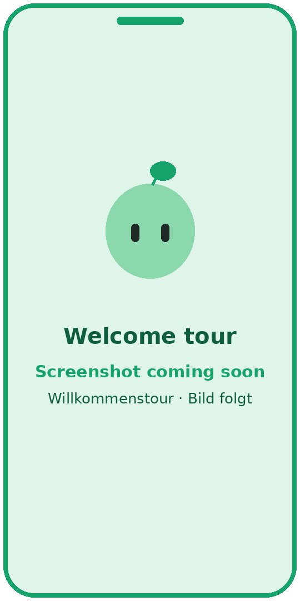
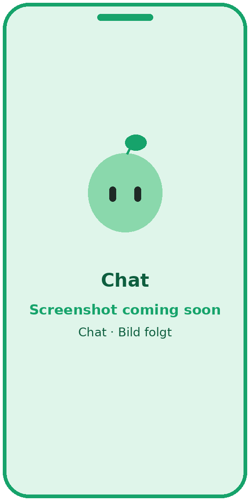
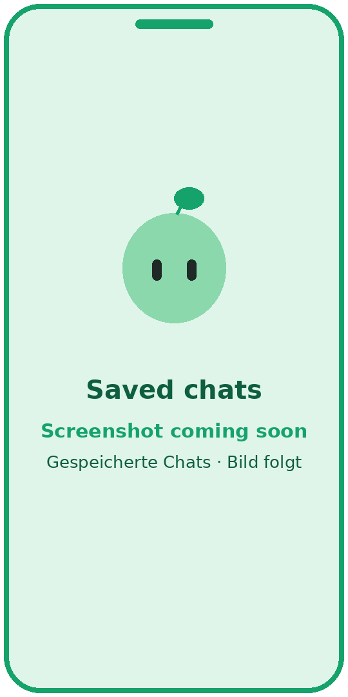
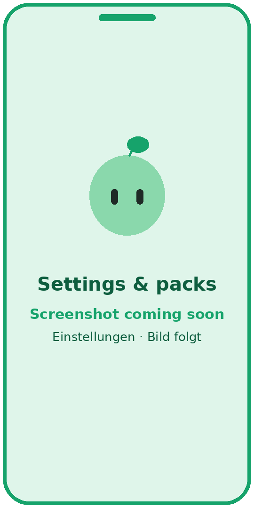
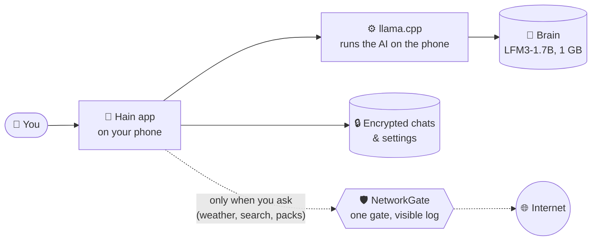

<div align="center">


# Hain

**Your AI. Your phone. Nobody else.**

A private AI assistant for Android that runs entirely on your phone.<br>
No account. No cloud. Free and open source. In English and German.

[](#status-and-roadmap) [](#system-requirements) [](https://github.com/oskar26/hain/releases/tag/nightly) [](https://github.com/oskar26/hain/actions/workflows/apk.yml)
<br>
[](LICENSE) [](#auf-deutsch) [](#privacy)

**[Download](https://github.com/oskar26/hain/releases/tag/nightly)** · [Install](#install-in-3-steps) · [Features](#features) · [How it works](#how-it-works) · [Privacy](#privacy) · [FAQ](#faq) · [Contributing](#contributing) · [Deutsch](#auf-deutsch)

Website: https://oskar26.github.io/hain/ *(coming soon)*

</div>

---

> [!WARNING]
> **Hain is in early development (alpha).** Things break, features are missing, and chats or settings may be reset between versions. Please don't rely on it for anything important yet. Feedback is very welcome!
>
> **Hain ist noch in früher Entwicklung (Alpha).** Es kann abstürzen, Funktionen fehlen noch, und Chats oder Einstellungen können zwischen Versionen verloren gehen. Freu mich über Feedback!

> [!NOTE]
> **About AI:** The AI inside Hain can be wrong or make things up, so check anything important. Hain itself is built by one person together with AI coding agents, and every change is reviewed by a human. Details in [How AI is used](#how-ai-is-used).

## What is Hain?

Hain is a chat assistant like ChatGPT, except the AI lives **on your phone** instead of in a data centre. Your questions, your chats and your memories stay on the device, encrypted, and nobody else can read them. A *Hain* is a small, sheltered grove: a quiet place that belongs to you.

<table>
  <tr>
    <td align="center" width="33%">📱<br><b>Runs on your phone</b><br><sub>The AI works on the device, even in flight mode</sub></td>
    <td align="center" width="33%">🙅<br><b>No account</b><br><sub>No sign-up, no e-mail, no API keys</sub></td>
    <td align="center" width="33%">☁️🚫<br><b>No cloud</b><br><sub>Chats are stored encrypted, only on your phone</sub></td>
  </tr>
  <tr>
    <td align="center">💚<br><b>Free &amp; open source</b><br><sub>GPL-3.0, no ads, no subscription</sub></td>
    <td align="center">🇬🇧 🇩🇪<br><b>English and German</b><br><sub>Every screen in both languages, plain words</sub></td>
    <td align="center">🌱<br><b>Meet Pim</b><br><sub>A friendly sprout who shows you around</sub></td>
  </tr>
</table>

### Meet Pim

<p align="center">
  
</p>

Pim is a small mint-green sprout and your guide in Hain. He shows you around in a short welcome tour, breathes, blinks and hops, squishes when you tap him and cheers with confetti once the brain is downloaded. While he thinks, a soft green glow rises from the bottom of the screen. If you turn off animations in your phone's settings, everything stays still.

## Screenshots

<table>
  <tr>
    <td align="center"><br><sub>Welcome tour</sub></td>
    <td align="center"><br><sub>Chat</sub></td>
    <td align="center"><br><sub>Saved chats</sub></td>
    <td align="center"><br><sub>Settings &amp; packs</sub></td>
  </tr>
</table>

<sub>Real screenshots are coming. To replace one, overwrite the matching file in <code>docs/readme/</code> (portrait, about 1:2).</sub>

## Features

✅ done (in the nightly) · 🚧 partly done · 🗓️ planned

| Area | What Hain does | Status |
|---|---|---|
| 💬 Chat | Streaming answers, Markdown and code, collapsible "thinking" block, stop (reacts at once), ask again on any answer, copy, share | ✅ |
| ⚡ Speed | Faster test build, brain loads in the background with progress, remembers the chat between answers instead of re-reading it, system prompt read ahead | ✅ |
| 🌍 Answer language | Pim answers in the language you write in (German, English, French, Turkish, Russian, …), or always in German or English if you want | ✅ |
| 🌱 First start | Playful welcome tour with Pim, brain download (LFM3-1.7B, 1.0 GB) with resume and checksum, celebration screen; the download can wait or run in the background | ✅ |
| 🗂️ Saved chats | Stored encrypted on the phone; search, rename, pin, delete, grouped by day | ✅ |
| ⚙️ Settings | Theme, easy-to-read font, answer mode (fast / auto / thorough), answer language, "about me" and answer style | ✅ |
| 📦 Knowledge packs | See, download and remove packs, with hints on what fits your phone | ✅ |
| 🎨 Personality | Living Pim, green "thinking" glow, soft 3D buttons | ✅ |
| ✏️ Chat extras | Automatic chat titles, copy or edit your own message (long press) | ✅ |
| 📤 Export | Export a chat as Markdown or PDF | 🗓️ |
| 🧭 Settings, part 2 | Clearer layout with icon tiles and sub pages, own "reduce motion" switch. Still open: pack picker, language step at first start, glossy 3D Pim and new first-start pictures | 🚧 |
| 🔧 Tools | Calculator and units, weather (Open-Meteo), Wikipedia (German/English) – Pim shows each step and its sources under the answer. Still open: web search without API key, read web pages, weather card | 🚧 |
| ⏰ Phone actions | Alarm, timer, calendar entry, navigation, always confirmed by you | 🗓️ |
| 🛡️ Network log | Every tool request goes through one gate: orange "Online" dot while it runs, offline mode, log of the last 7 days in Settings → Privacy. Still open: brain download through the gate, log kept across app restarts | 🚧 |
| 📰 News | Standard mix (incl. junge Welt), standard + own feeds, or only own feeds | 🗓️ |
| 🃏 Answer cards | Lists, tables, checklists, weather and source cards instead of plain text | 🗓️ |
| 🧠 Memory | "Remember that …", a memory page you can edit, forget anything | 🗓️ |
| 🔒 Private chats | Chats that are never saved, app lock with fingerprint | 🗓️ |
| 📄 Documents | Ask your PDFs and photos of text (PP-OCRv5), answers with sources | 🗓️ |
| 🎙️ Voice | Dictation (Moonshine), read aloud, Pim's own voice | 🗓️ |
| 📲 On the phone | Share menu target, widget, quick tile, default assistant | 🗓️ |
| 🌳 Mini-apps | Many key-free integrations (e.g. KVB / Transitous), shown as trees in Pim's forest | 🗓️ later |
| 🖼️ Images | Erase objects, remove background, upscale; optional image generation pack | 🗓️ later |

The live state is in [docs/workflow/STATUS.md](docs/workflow/STATUS.md), the plan in [docs/workflow/ROADMAP.md](docs/workflow/ROADMAP.md).

### New in the latest test build

- **Pim can look things up now.** Ask "Wie wird das Wetter morgen in Köln?" or "Wer war Ada Lovelace?" and Pim fetches the weather (Open-Meteo) or a Wikipedia summary, then answers from it. Above the answer you see what Pim did ("Wetter · Köln ✓"), below it the sources as chips – tap one to open the page.
- **Exact maths.** Pim calculates with a real calculator instead of guessing: "15% von 80", "sqrt(2)", "5 km in Meilen", "100 °F in °C". Type only a sum like "12*7" and the result is there at once, without waiting for the brain.
- **You see when Hain goes online.** While a request runs, an orange "Online" dot shows in the top bar. Settings → Privacy lists every request of the last 7 days (when, where to, why, how big) – without what you asked, unless you switch on "Show full addresses". **Offline mode** there stops all of it.
- **Pim answers in German when you write German.** Pim's instructions are now fully in German on a German phone (or with answer language "Deutsch"), end with a clear language rule, and every answer gets a tiny "answer in German/English" note. No more English or half-English replies to "wie geht es dir". And it works for every language: write French, Spanish, Turkish, Polish, Russian or Arabic, and Pim answers in that language (the small brain is best in German and English). Pim also sounds more natural: a few warm sentences instead of one generic line, no "Hallo!" in front of every answer, and honest when something is uncertain.
- **Faster.** The test APK is now built like a real release (not "debuggable"), so screens and scrolling should feel clearly smoother. Pim and the green thinking glow move without slowing the rest of the screen down.
- **The brain remembers the chat.** Before, every answer made the brain read the whole chat again. Now it continues where it stopped, so answers in longer chats start sooner. While it wakes up, the top bar shows how far it is (in %).
- **Stop means stop.** Tapping stop ends the answer at once, even while Pim is still reading your message.
- **Chat titles by themselves.** After the first answer Pim gives the chat a short title. A name you typed yourself is never changed.
- **Your own messages.** Long-press one of your messages to copy it or to edit it: Pim then answers again from there. "Ask again" works on every answer, also the first one.
- **Brain later.** At the first start you can skip the download (or let it run in the background) and look around first. The chat then shows a small, quiet reminder instead of an error.
- **Keyboard fixed.** With the keyboard open in an empty chat the top bar stays put and Pim simply gets smaller.
- **Small menu in the chat list.** The ⋯ button opens a compact menu right at the chat (pin, rename, delete).

## Install in 3 steps

You don't need to be technical. Hain is not in the Play Store yet, so you install it directly from GitHub.

1. **Download.** Open the [nightly release](https://github.com/oskar26/hain/releases/tag/nightly) on your phone and tap **`hain-debug.apk`**.
2. **Allow and install.** Open the downloaded file. Android will ask whether your browser may "install unknown apps". Tap **Settings**, switch on **Allow from this source**, go back and tap **Install**.
   <sub>This only lets this one app (your browser) install apps. You can switch it off again afterwards under *Settings → Apps → Special app access → Install unknown apps*. Google Play Protect may show a warning because Hain isn't from the Play Store; that's expected.</sub>
3. **Open Hain.** Pim welcomes you and downloads the brain (about 1 GB). Use Wi-Fi if you can, or skip it and get it later from the chat. After that, Hain works without internet.

**Updating:** download the newest `hain-debug.apk` from the same page and install it over the old one. Your chats stay. Every change to `main` builds a new nightly, and all nightlies are signed with the same key, so they install as an update. (In the alpha, a big update can still reset chats or settings.)

### System requirements

| | Minimum | Recommended |
|---|---|---|
| Android | 10 (API 29) | newer is fine |
| Memory (RAM) | 4 GB | 6 GB or more |
| Free storage | about 1.5 GB (brain 1.0 GB + app) | more for optional packs |
| Internet | only for the first download | Wi-Fi for knowledge packs |

<sub>No Google services needed. Smaller phones may be slow; Hain tells you which knowledge packs fit your device.</sub>

## How it works



Everything inside the phone works offline. Hain goes online only to download knowledge packs, or later when you ask for something from the internet (like the weather or a web search). All of that will go through **one gate, the NetworkGate**, which shows you where each request went. *(The tools and the NetworkGate are planned for 0.2.0, see [Features](#features).)*

## Knowledge packs

Hain speaks of "knowledge packs" instead of "models". Only the brain is needed; everything else is optional.

| Pack | Model | Size | Purpose |
|---|---|---|---|
| Brain (base) | LFM3-1.7B QAD Q4_0 | 1.0 GB | chat, tools, memory |
| Remember & files | LFM2.5-Embedding-350M | ~0.2 GB | search in memory, chats, files |
| Reading text | PaddleOCR PP-OCRv5 mobile (Latin) | 12 MB | PDFs and photos, without Google |
| Dictation | Moonshine Small | ~0.12–0.25 GB | microphone, DE + EN |
| See + talk (optional) | LFM3-Omni-2B | 1.65 GB | photos, voice mode |
| Image generation (optional) | SD 1.5 + DMD2 | 1.1 GB | only phones with 8 GB RAM+ |

Details: [docs/specs/MODELS.md](docs/specs/MODELS.md).

## Privacy

- **No account, no analytics, no ads.** No telemetry, no Google Play Services, no Firebase.
- **Your data stays on the phone.** Chats and settings are stored in an encrypted database; the key is kept in Android's secure keystore.
- **Not used for training.** Your chats are not sent anywhere and are not used to train any model.
- **Online only when needed.** Hain goes online to download a knowledge pack, or when Pim looks something up for you (weather, Wikipedia). Only the short question goes out, never your chat. Each lookup shows up in the network log (Settings → Privacy), and offline mode turns it off completely.

Details: [docs/specs/ARCHITECTURE.md](docs/specs/ARCHITECTURE.md).

## How AI is used

**In the app:** Hain runs an open language model (LFM3 1.7B by Liquid AI) on your phone. It can be wrong, make things up, or sound more sure than it is. Check anything important, especially health, money and legal questions. Hain does not replace a doctor, a lawyer or therapy. Actions that reach other people (SMS, calls, mail) will always need your OK.

**Building the app:** Hain is made by one person (Oskar) together with AI coding agents. Large parts of the code, docs and graphics are written or drafted by AI (an AI assistant plus local models via llama.cpp). Every change goes through a pull request that a human reviews, tests and merges. If you find code that looks copied or wrong, please [open an issue](https://github.com/oskar26/hain/issues).

## Principles

- **Local first.** The model, your chats and your memory stay on the device, encrypted.
- **Online only when visible.** Every network request goes through one gate and shows up in a log you can read.
- **Own code, no forks.** Libraries like llama.cpp are dependencies (git submodule), never copied or modified.
- **Light on storage.** A small base pack (~1 GB brain), everything big is an optional download.
- **Simple for everyone.** Plain language, no jargon, large text, light and dark.
- **Honest.** Hain says when it's unsure and asks before acting for you.

**Who it is for:** people who care about privacy but aren't tech experts, and people who are critical of power-hungry data centres. Teachers, students, seniors with their first smartphone, F-Droid fans: everyone who wants a helpful AI without handing their data to anyone.

## Status and roadmap

| Version | What | When |
|---|---|---|
| nightly | Every merge to `main`, for testers | ongoing |
| **0.2.0** | First version for friends: chat that stays on your phone, settings, knowledge packs, tools (calculator, weather, Wikipedia, web search, timer), news, memory, private chats | **planned for 6 Nov 2026** |
| 1.0 | Everything in the [concept](docs/concept/KONZEPT.md): documents and photos, voice, mini-apps "forest", F-Droid | 2027, no fixed date |

Dates are goals, not promises. The detailed plan is in [docs/workflow/ROADMAP.md](docs/workflow/ROADMAP.md), the current state in [docs/workflow/STATUS.md](docs/workflow/STATUS.md).

## FAQ

<details>
<summary><b>Is Hain really free?</b></summary>

Yes. Hain is free and open source under the GPL-3.0. There are no ads, no subscription and no paid "pro" version.
</details>

<details>
<summary><b>Does it work without internet?</b></summary>

Yes. After the first download of the brain (about 1 GB), chatting works fully offline, even in flight mode. You only need internet for new knowledge packs and, later, for things like weather or web search.
</details>

<details>
<summary><b>Will it work on my phone?</b></summary>

You need Android 10 or newer. The brain needs at least 4 GB of RAM; 6 GB or more is recommended. Hain checks your phone and tells you which packs fit. iPhones are not supported.
</details>

<details>
<summary><b>Is it safe to install an app from outside the Play Store?</b></summary>

Installing from GitHub is normal for open-source apps. The whole source code is public, and every APK is built automatically by GitHub Actions from that code. Only install Hain from the official [release page](https://github.com/oskar26/hain/releases/tag/nightly).
</details>

<details>
<summary><b>How good is it compared to ChatGPT?</b></summary>

The brain is much smaller than cloud models, so it knows less and makes more mistakes, especially with facts and long texts. In return it is fast, private and works offline. For everyday questions, writing help and explanations it is often good enough.
</details>

<details>
<summary><b>Are my chats used to train AI?</b></summary>

No. Your chats never leave your phone, so nobody can use them for training.
</details>

<details>
<summary><b>Why does it say "nightly" and "debug"?</b></summary>

Hain is in alpha. The nightly is built automatically after every change, for testers. The first proper release is 0.2.0, and later Hain should come to F-Droid.
</details>

<details>
<summary><b>I found a bug or have an idea. Where do I tell you?</b></summary>

Please [open an issue](https://github.com/oskar26/hain/issues): what you did, what happened, your phone model and a screenshot if you can. See [CONTRIBUTING.md](CONTRIBUTING.md).
</details>

## Contributing

Ideas, bug reports, translations and pull requests are welcome. Start with **[CONTRIBUTING.md](CONTRIBUTING.md)**. The easiest way to help: install the nightly, use it, and [open an issue](https://github.com/oskar26/hain/issues) with what broke or what you'd like.

**Working on the code:** humans and coding agents start with **[AGENTS.md](AGENTS.md)**: one task from [TASKS.md](docs/workflow/TASKS.md) per session, one commit per task (`T-XXX: title`), all checks green, status and handoff log updated.

## Build from source

```bash
git clone --recursive https://github.com/oskar26/hain.git
cd hain
./gradlew assembleDebug                  # full build incl. llama.cpp (needs NDK 27 + CMake 3.31)
./gradlew assembleDebug -Phain.native=false   # Kotlin only, no native code
./gradlew testDebugUnitTest ktlintCheck detekt
python3 tools/check_strings.py           # every UI string in EN and DE
```

JDK 21 is required (see [KNOWN_ISSUES.md](docs/workflow/KNOWN_ISSUES.md)). CI builds the APK for every pull request (`.github/workflows/apk.yml`).

## Tech

Kotlin + Jetpack Compose (no Material 3, own design system), Hilt, Room (encrypted with SQLCipher), DataStore, WorkManager, OkHttp, llama.cpp via JNI with runtime CPU selection.

Modules: `app`, `core-*` (llm, data, tools, ui, cards, memory, docs, voice, models), `feature-*` (chat, onboarding, settings, news, memory, image).

Architecture: [docs/specs/ARCHITECTURE.md](docs/specs/ARCHITECTURE.md) · Design: [docs/specs/DESIGN_SYSTEM.md](docs/specs/DESIGN_SYSTEM.md) · Libraries & licences: [docs/specs/LICENSES.md](docs/specs/LICENSES.md) · Concept (DE): [docs/concept/KONZEPT.md](docs/concept/KONZEPT.md)

## Auf Deutsch

Hain ist ein privater KI-Assistent fürs Android-Handy, der komplett auf dem Gerät läuft: chatten, rechnen, Wetter und Wikipedia nachschauen, und bald auch im Web suchen, Fotos und PDFs verstehen, sprechen und sich Dinge merken. Keine Cloud, kein Konto, keine API-Schlüssel. Ins Internet geht Hain nur, wenn du etwas brauchst, und zeigt dir genau, wohin die Anfrage geht. Das ganze Konzept steht in [docs/concept/KONZEPT.md](docs/concept/KONZEPT.md).

**Installieren:** Auf dem Handy die [Nightly-Seite](https://github.com/oskar26/hain/releases/tag/nightly) öffnen, `hain-debug.apk` laden, beim Öffnen „Unbekannte Apps installieren“ für den Browser erlauben, installieren. Beim ersten Start lädt Pim das Gehirn (ca. 1 GB, am besten im WLAN) – das kannst du auch überspringen und später im Chat nachholen. Updates einfach drüber installieren, Chats und Gehirn bleiben erhalten.

**Stand:** Hain ist noch in Entwicklung (Alpha). Version 0.2.0 für Freundinnen und Freunde ist für den 6. November 2026 geplant, Version 1.0 für 2027. Beim Programmieren helfen KI-Agenten, jede Änderung wird aber von einem Menschen geprüft. Die KI in der App kann sich irren, prüf wichtige Antworten lieber nach. Mitmachen: Fehler und Wünsche einfach als [Issue](https://github.com/oskar26/hain/issues) melden, siehe [CONTRIBUTING.md](CONTRIBUTING.md).

## Licence

[GPL-3.0](LICENSE). Model weights are not bundled and keep their own licences (e.g. LFM Open License v1.0).

## Credits

- [llama.cpp](https://github.com/ggml-org/llama.cpp) by ggml-org: runs the AI on the phone (MIT).
- [Liquid AI](https://www.liquid.ai/) for the LFM3 models ([LiquidAI/LFM3-1.7B-GGUF](https://huggingface.co/LiquidAI/LFM3-1.7B-GGUF), LFM Open License v1.0).
- [Lucide](https://lucide.dev/) icons, the Inter and Atkinson Hyperlegible fonts, and all other libraries listed in [LICENSES.md](docs/specs/LICENSES.md).

<div align="center">
<sub>Made with 💚 · <a href="#hain">Back to top ↑</a></sub>
</div>
