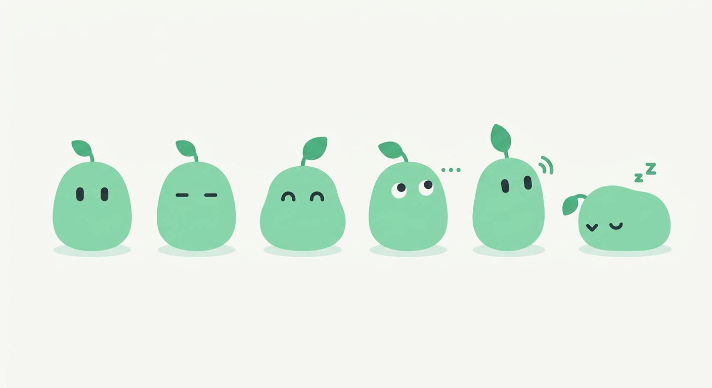
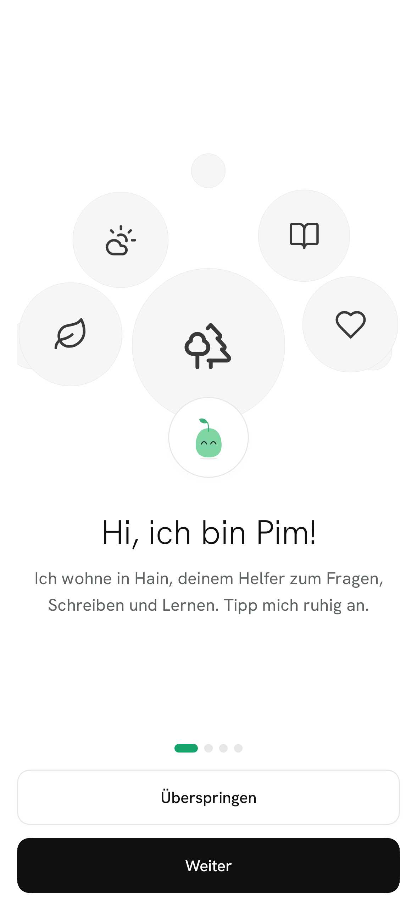
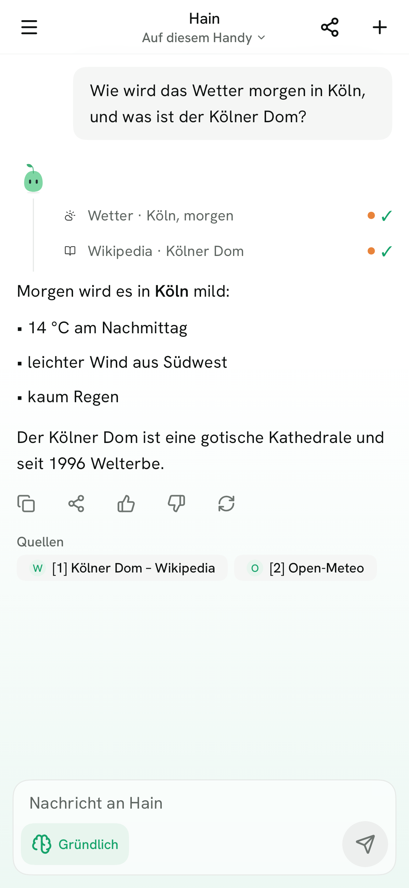
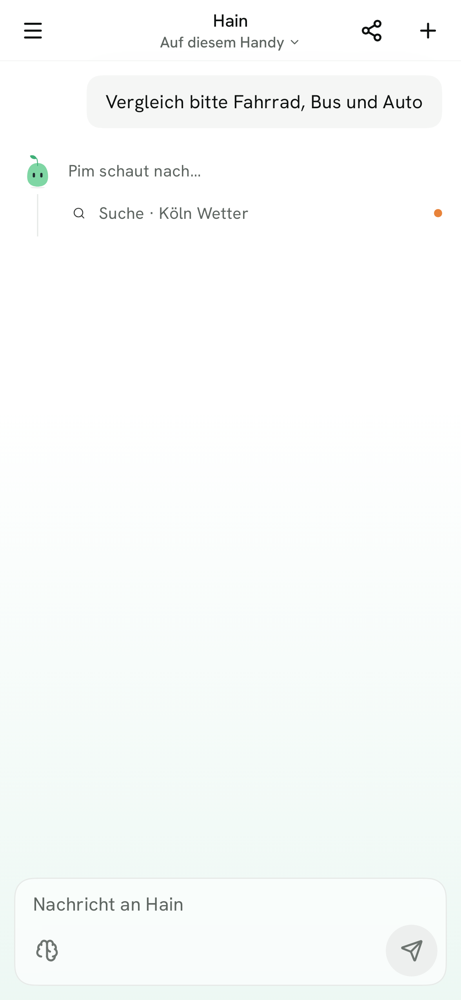
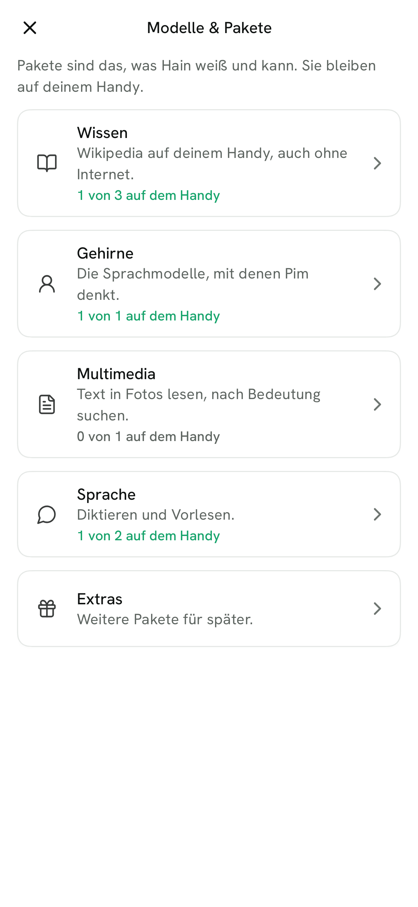
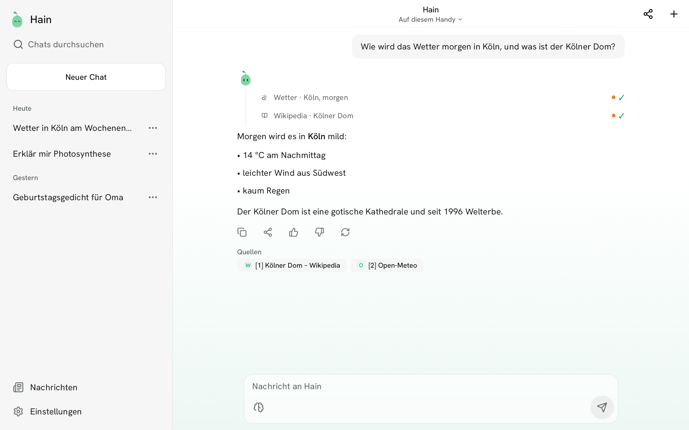

<div align="center">


# Hain

**Your AI. Your phone. Nobody else.**

A private AI assistant for Android that runs entirely on your phone.<br>
No account. No cloud. Free and open source. In English and German.

[](#status-and-roadmap) [](#system-requirements) [](https://github.com/oskar26/hain/releases/tag/nightly) [](https://github.com/oskar26/hain/actions/workflows/apk.yml)
<br>
[](LICENSE) [](#auf-deutsch) [](#privacy)

**[Download](https://github.com/oskar26/hain/releases/tag/nightly)** · [Install](#install-in-3-steps) · [Features](#features) · [How it works](#how-it-works) · [Privacy](#privacy) · [FAQ](#faq) · [Contributing](#contributing) · [Deutsch](#auf-deutsch)

Website: https://oskar26.github.io/hain/

</div>

---

> [!WARNING]
> **Hain is in early development (alpha).** Things break, features are missing, and chats or settings may be reset between versions. Please don't rely on it for anything important yet. Feedback is very welcome!
>
> **Hain ist noch in früher Entwicklung (Alpha).** Es kann abstürzen, Funktionen fehlen noch, und Chats oder Einstellungen können zwischen Versionen verloren gehen. Freu mich über Feedback!

> [!NOTE]
> **About AI:** The AI inside Hain can be wrong or make things up, so check anything important. Hain itself is built by one person together with AI coding agents, and every change is reviewed by a human. Details in [How AI is used](#how-ai-is-used).

## What is Hain?

Hain is a chat assistant like ChatGPT, except the AI lives **on your phone** instead of in a data centre. Your questions, your chats and your memories stay on the device, encrypted, and nobody else can read them. A *Hain* is a small, sheltered grove: a quiet place that belongs to you.

<table>
  <tr>
    <td align="center" width="33%">📱<br><b>Runs on your phone</b><br><sub>The AI works on the device, even in flight mode</sub></td>
    <td align="center" width="33%">🙅<br><b>No account</b><br><sub>No sign-up, no e-mail, no API keys</sub></td>
    <td align="center" width="33%">☁️🚫<br><b>No cloud</b><br><sub>Chats are stored encrypted, only on your phone</sub></td>
  </tr>
  <tr>
    <td align="center">💚<br><b>Free &amp; open source</b><br><sub>GPL-3.0, no ads, no subscription</sub></td>
    <td align="center">🇬🇧 🇩🇪<br><b>English and German</b><br><sub>Every screen in both languages, plain words</sub></td>
    <td align="center">🌱<br><b>Meet Pim</b><br><sub>A friendly sprout who shows you around</sub></td>
  </tr>
</table>

### Meet Pim

<p align="center">
  
</p>

Pim is a small mint-green sprout and your guide in Hain. He shows you around in a short welcome tour, breathes, blinks and hops, squishes when you tap him and cheers with confetti once the brain is downloaded. While he thinks, a soft green glow rises from the bottom of the screen. If you turn off animations in your phone's settings, everything stays still.

## Screenshots

<table>
  <tr>
    <td align="center"><br><sub>Welcome tour</sub></td>
    <td align="center"><br><sub>Chat</sub></td>
    <td align="center"><br><sub>Pim looks it up</sub></td>
    <td align="center"><br><sub>Models &amp; packs</sub></td>
  </tr>
</table>

<p align="center"><br><sub>On tablets the chat list stays open</sub></p>

## Features

✅ done (in the nightly) · 🚧 partly done · 🗓️ planned

| Area | What Hain does | Status |
|---|---|---|
| 💬 Chat | Streaming answers, Markdown and code, collapsible "thinking" block, stop (reacts at once). Under every answer a quiet row: copy, share, thumbs up/down (stays on your phone), ask again | ✅ |
| ⚡ Speed | Faster test build, brain loads in the background with progress, remembers the chat between answers instead of re-reading it, system prompt read ahead. Release build shrunk and optimised with R8, with a baseline profile so the app starts and scrolls faster from the first start (also without Play) | ✅ |
| 🌍 Answer language | Pim answers in the language you write in (German, English, French, Turkish, Russian, …), or always in German or English if you want | ✅ |
| 🌱 First start | Playful welcome tour with Pim, brain download (LFM3-1.7B, 1.0 GB) with resume and checksum, celebration screen; the download can wait or run in the background | ✅ |
| 🗂️ Saved chats | Stored encrypted on the phone; search, rename, pin, delete, grouped by day | ✅ |
| ⚙️ Settings | Theme, app icon (3D or flat), easy-to-read font, answer mode (fast / auto / thorough), answer language, "about me" and answer style. Thinking level also right in the message box (brain button) | ✅ |
| 🧠 Choose the brain | Tap "Hain · On this phone" at the top: a small frosted menu lists the brains on your phone with a plain name ("Quick brain"), model and size, marks the one recommended for your phone and loads your pick in the background with progress. Brains not on your phone lead to Knowledge packs | ✅ |
| 📦 Models & packs | Settings → Models & packs, sorted into Knowledge, Brains, Multimedia, Voice and Extras: see, download and remove packs, with hints on what fits your phone. **Wikipedia offline** (German ~136 MB or all articles ~4.7 GB, English ~297 MB or 1 million articles ~3 GB): with a pack the Wikipedia tool answers without internet | ✅ |
| 🎨 Look | One calm design "Lichtung": lots of white, fine hairlines, Hain green only as an accent, radii 12–16 dp, quiet line icons; light font (Hanken Grotesk), dark mode; "Reduce motion" stops all movement | ✅ |
| 📱 Tablets | From 840 dp width (tablet in landscape, open foldable, big split screen) the chat list stays open on the left, and settings show the list and the open page side by side. Phones stay as they are | ✅ |
| 🌱 Pim | Lives everywhere (start page, thinking, done, errors, empty search, pull gestures) and the leaf always stays on his head. Tap him for a different little reaction each time, drag him around on the start page and he springs back | ✅ |
| 📳 Haptics | Fine, crisp clicks instead of buzzing – send, switches, thinking level, answer done, menus, confirming a delete, pull gestures, errors. Never while text streams. Settings → Look → Vibration: Off / Subtle (default) / Normal / Strong | ✅ |
| 🎮 Secret | Hold Pim on the start page for 5 seconds without letting go … (hint: 2048) | ✅ |
| 🪟 Frosted glass | Top bar and message box float as frosted glass over the chat, which scrolls under them; ⋯ menus, long-press menus, the thinking picker, the ↓ button and the side panel too (Android 12+, a calm solid surface on older phones and in battery saver). One Pim status shows waiting, thinking, looking up and writing | ✅ |
| ℹ️ About Hain | Pim, version (with build number and commit), website, code on GitHub, licence and open-source licences – links open only after your tap | ✅ |
| 🔄 Update check | Optional: once a day at start Hain asks GitHub if a newer version is out (stable or nightly) and shows a calm hint that opens the release page. Off until you say yes, nothing is installed by itself, the request shows in the network log | ✅ |
| 🛠️ Developer mode | Hidden: tap the version in "About Hain" 7 times. Own GGUF model from Hugging Face (size, RAM hint, download with progress), sampling, context size, thinking, own system prompt, tokens per second under answers | ✅ |
| ✏️ Chat extras | Automatic chat titles; tap your own message to edit or copy it. Chat list: small glass menu at each chat (pin, rename, delete), smooth drawer | ✅ |
| 🌿 Versions & next question | Edit a message or ask again and the old version stays – switch with "‹ 2/3 ›" under the message. Send your next question while Pim still answers: it waits ("wartet", ✕ takes it back) and goes out afterwards. A frosted "↓" brings you back down ("Neue Antwort" when something new came in); the chat only follows new text while you are at the bottom | ✅ |
| 📤 Export | Save or share a chat as Markdown or as a tidy PDF (title, date, roles, code, page numbers); all chats at once as a Markdown ZIP in Settings → Privacy | ✅ |
| 🧭 Settings, part 2 | Glass tiles with their own colour and 3D icon, sub pages, own "reduce motion" switch, glossy 3D Pim, new first start with a language step, brain picker in the top bar | ✅ |
| 🔧 Tools | Calculator and units, weather (Open-Meteo), Wikipedia (German/English), web search without API key that reads several pages (or your own SearXNG), reading a link, alarm (also repeating, e.g. every weekday), timer, calendar entry and route with a confirm card (or start after 3 s with Undo), weather and Wikipedia cards under the answer, weather for your location if you allow it, web search on / ask first / off – Pim shows each step and its sources under the answer. with the small icon of each site at the sources (switch off in Settings → Privacy → Source images) | ✅ |
| ⏰ Phone actions | Alarm, timer, calendar entry, navigation – prepared by Pim as a glass card, done only after your tap | ✅ |
| 🛡️ Network log | Every tool request goes through one gate: orange "Online" dot while it runs, offline mode, log of the last 7 days in Settings → Privacy. The log now stays after a restart (7 days, encrypted), and the brain download goes through the gate too | ✅ |
| 📰 News | Drawer → News: headlines of today, yesterday and before from a fixed mix of 14 sources in German and English (tagesschau, Deutschlandfunk, ZEIT, taz, junge Welt, nd, BBC, Guardian, DW, Al Jazeera, Jacobin, Democracy Now!, CORRECTIV fact checks, Full Fact). Only three choices: Standard, Standard + my feeds, My feeds only – add any RSS/Atom address, rename or delete it. Tap opens the article, long press shares the link, "Summarise" lets Pim sum up a freely readable article in 5 points on your phone (paywalls are never bypassed). Pim can also look at the headlines in the chat ("What's new about the strike?") and shows them as a card. Feeds load only when you open News or ask Pim and show as "News" in the network log | ✅ |
| 🃏 Answer cards | Lists, tables, checklists, progress bars and buttons right in the answer: tick items off (saved with the chat), copy, share or ask the next question with one tap. Bar and line charts for numbers (TalkBack reads them as a sentence); while Pim writes a card, a small grammar keeps it in shape. Still open: pictures in cards | ✅ |
| 🧠 Memory | "Remember that …" / "Merk dir, dass …" and "Forget that …", Pim can also keep something itself (`remember` tool); fitting memories go into the answer, found by meaning with the optional pack "Search by meaning" (LFM2.5-Embedding, 219 MB). Chips under the answer: "Saved ✓ · Undo" and "3 memories used" (tap shows which). After a chat Pim suggests facts it noticed (only used after your yes; an update shows "Replaces: …"). Settings → Memory: search, edit, delete, undo, topics with your own note, suggestions, on/off, export/import as a file, delete all. Everything stays encrypted on the phone | ✅ |
| 🔒 Private chats | Private chat (eye button at the top): never saved, never searched, deleted when you leave it, tools still work. App lock with fingerprint or the phone's PIN (right away / 1 min / 5 min), block screenshots | ✅ |
| 📄 Documents | Paper clip in the message box → **File or photo** (PDF, photo of a page, .txt/.md) or **My files**. Hain reads the text on your phone with a progress line, shows the file as a chip ("Rechnung.pdf · 3 Seiten") and Pim answers from it with page numbers like [S. 2]: small files go into the question whole, long ones are searched (the best 4 parts). Scans and photos need the optional text recognition (PP-OCRv5, ~14 MB, asked first, with a German fix for Ü/ß). Only the text is kept, encrypted; **My files** lists everything, delete a file or remove the pack | ✅ |
| 🎙️ Voice | Dictation with the mic in the message box (Moonshine Small, German + English, on your phone, speech pack loads on first use), read aloud under every answer (phone voice in Pim's pitch). Still open: Pim's own voice (Pocket TTS), voice mode | 🚧 |
| 📲 On the phone | Share text or links from any app into Hain (new chat, text in the box, nothing sent by itself), home screen widget "Ask Pim" (ask, new chat, last chat), quick settings tile "New chat". Still open: sharing pictures/PDFs, default assistant | 🚧 |
| 🌳 Mini-apps | Many key-free integrations (e.g. KVB / Transitous), shown as trees in Pim's forest | 🗓️ later |
| 🖼️ Images | Erase objects, remove background, upscale; optional image generation pack | 🗓️ later |

The live state is in [docs/workflow/STATUS.md](docs/workflow/STATUS.md), the plan in [docs/workflow/ROADMAP.md](docs/workflow/ROADMAP.md).

### New in the latest test build

- **Version 0.1.10.2 – UI polish, offline Wikipedia, tablets.**
  - **Frosted glass over the chat.** The top bar and the message box now float as frosted glass over the chat – the chat scrolls under them and shows through softly. The title sits truly in the middle. Menus, the thinking picker, the ↓ button and the side panel use the same, a bit stronger glass; in battery saver and on phones older than Android 12 they are a calm solid surface.
  - **One Pim status.** Waiting, thinking, looking something up and writing are now one small element with Pim instead of several lines.
  - **Tidier settings.** The first page only lists the groups. Everything to download is under **Models & packs**: Knowledge, Brains, Multimedia, Voice and Extras, each on its own page with “2 of 3 on your phone”. **News** has its own entry.
  - **Wikipedia without internet.** Under **Models & packs → Knowledge** you can load Wikipedia for your phone (German: top articles ~136 MB or all ~4.7 GB; English: top ~297 MB or 1 million articles ~3 GB). With a pack, Pim's Wikipedia tool reads from your phone first – also in flight mode – and only goes online if the article is not in it.
  - **News and honest steps.** “Was gibt’s Neues?” without a topic brings the top headlines. When a tool step fails, the step says why in plain words, and Pim does not repeat the same search again and again.
  - **Tablets and wide screens.** From 840 dp width the chat list stays open on the left as a calm side panel, and **Settings** show the list on the left and the open page on the right.
- **Version 0.1.10.1 – charts, site icons, steadier cards** (from 0.1.6.1).
  - **Charts in cards.** Numbers to compare or over time now come as a calm **bar** or **line chart** in Hain green. Try “Ich habe Mo 2, Di 3, Mi 1, Do 4 und Fr 2 Stunden gelernt, zeig das als Liniendiagramm” or ask for the weather of the next days as a chart. TalkBack reads the chart as one sentence (how many values, which is the highest).
  - **Cards stay in shape.** While Pim writes a card, a small grammar only lets through what a card can be, so lists, tables and charts break less often. Everything outside the card is written as before, and if something still goes wrong you simply see the text.
  - **Site icons at the sources.** The source chips under an answer now show the small icon of each website. Each icon is loaded once, straight from that website (never from an icon service), through the network gate (you see it in the network log, offline mode blocks it) and then kept on your phone. Don’t want that? **Settings → Privacy → Source images** off, then you see the first letter instead.
- **Version 0.1.4.1 – Pim picks the right tool more often.** All tools were reworked for the small brain: shorter, clearer tool descriptions, "8 min" really becomes an 8-minute timer, "Freitag 18 Uhr" lands on the right day, "zu Fuß" or "Fahrrad" work for routes, and a half-broken tool call from the brain is repaired instead of showing up as code in the chat. If something is missing (a route without a destination, the weather without a place while location is off), Pim asks. Follow-ups like "und in München?" call the tool again, links you send are read. Spoken sums ("was ist 17 mal 23") and "Wie spät ist es?" are answered instantly without the brain. Measured with 52 test questions: right tool 88.5 % → 96.2 %.
- **Choose Pim's brain at the top.** Tap **"Hain · On this phone"** at the top of the chat. A small frosted-glass menu shows the brains on your phone with a plain name ("Quick brain", "Balanced brain", "Smart brain"), the model and its size, and marks the one **recommended for your phone**. Tap another one and it loads in the background – a thin green line under the top bar shows how far it is; a running answer stops first. Hain remembers your pick. Brains that are not on your phone yet, and "More brains", open **Knowledge packs**. (Today the catalogue has one brain; more follow.)
- **Faster start for the release build.** The release version of Hain is now shrunk and optimised (R8) and carries a "baseline profile": the parts that run at start and while you scroll through a chat are compiled ahead of time on your phone – also when you install Hain from GitHub or F-Droid, without Play. A test in CI installs this build on an emulator, checks that it starts and measures how fast. The test build `app.hain.debug` stays as it is.
- **Version 0.1.8 – private chat, app lock and export.**
  - **Private chat.** Tap the **eye** at the top of an empty chat. A green bar says "Privater Chat": nothing is saved, the chat never shows up in the list or the search, the memory never sees it, and it is deleted as soon as you leave it (new chat, other chat, "Beenden" or closing Hain). Tools like weather and search still work.
  - **App lock.** **Settings → Privacy → App lock**: Hain asks for your fingerprint (or face) or your phone's PIN, pattern or password when you come back – right away, after 1 minute or after 5 minutes. Switching it on asks once to confirm it's you. Hain stores nothing for this; your phone checks. Without a screen lock on the phone you get a short hint instead. Coming back from the file picker or share sheet you opened in Hain does not lock.
  - **Block screenshots.** Also in **Privacy**: no screenshots or screen recordings of Hain, and a blank preview in recent apps.
  - **Export a chat.** In an open chat tap **Share** at the top (or ⋯ → **Exportieren** in the side panel): **PDF** or **Markdown**, to **share** with any app or to **save** where you choose. The PDF is set like a little document: title, date, "Du" and "Hain" (in green), paragraphs, lists, code on a grey band, page numbers. The thinking is left out.
  - **Export all chats.** **Settings → Privacy → Export all chats** saves one ZIP with every chat as a Markdown file (private chats are never in it).
- **Version 0.1.8: versions, waiting messages, sharing, widget.**
  - **Old versions stay.** When you edit one of your messages or tap "ask again", the old version is no longer thrown away. Under the message you see **‹ 2/3 ›** – tap the arrows to switch between the versions, together with everything that came after them. Your choice is saved.
  - **Send while Pim answers.** You can type and send your next question while Pim is still writing. It waits above the message box ("wartet"), the ✕ takes it back, and it goes out on its own as soon as the answer is done. Stop ends only the current answer.
  - **Calmer scrolling.** The chat only follows new text while you are at the bottom. Scroll up to read and it stays where you are; a small frosted **↓** brings you back, and says **"Neue Antwort"** when something new came in.
  - **Share into Hain.** In any app tap **Share → Frag Pim**: a new chat opens with the text or link in the message box (a shared link keeps its page title). Nothing is sent until you tap send.
  - **Widget and quick tile.** Add the **"Frag Pim"** widget to your home screen: the field opens a new chat with the keyboard, **+** starts a new chat, below it your last chat. In the quick settings you can add the tile **"Neuer Chat"**.
- **Version 0.1.10: Pim listens and talks.** Tap the **mic** next to send and speak – tap again (or tap **Fertig**) when you are done; or **hold** the mic while you speak and let go. Slide off the button or tap ✕ to throw it away. Green bars show that Pim hears you, then “Pim schreibt mit…”, and the text lands in the message box, where you can still change it before sending. It works in German and English (the language of your answers) and **completely on your phone**: the first time, Pim asks for the mic (only then) and loads a speech pack once (German 166 MB, English 209 MB, also in Settings → Knowledge packs). The recording is never stored and never leaves the phone.
- **Read aloud.** Under every answer there is now a speaker: Pim reads the answer sentence by sentence, without the Markdown signs (code blocks are skipped, links are read as their domain). Tap again to stop. For now this is your phone's own voice, a bit higher and faster like Pim; Pim's own voice comes later.
- **Version 0.1.4 – tools, the rest.**
  - **Repeating alarms.** "Weck mich jeden Werktag um 6:30", "täglich um 7", "montags und donnerstags um 8": the card shows the days (Mo–Fr, Jeden Tag …) and your clock app gets a repeating alarm.
  - **Pim says what really happened.** After an alarm, timer, event or route Pim now says "vorbereitet – tipp auf Stellen" instead of "eingestellt", because nothing happens before your tap. The card says it too.
  - **Without asking, if you like.** New switch **Settings → Privacy → Confirm phone actions** (on by default). Off: the card counts down 3 seconds with **Undo**, then your clock, calendar or map app opens by itself. Only for answers written just now, never when you open an old chat.
  - **Weather and Wikipedia as cards.** Under the answer you now see a small weather card (place, temperature now, one line per day with rain chance and high/low) or a Wikipedia card (title, three lines, "Auf Wikipedia lesen" – opens only when you tap).
  - **Weather where you are.** Switch on **Settings → Privacy → Location for weather** and Android asks once. Then "Wie wird das Wetter?" without a place uses your phone's last rough location (no GPS search, no Google services); only about 1 km goes to Open-Meteo.
  - **Web search: on, ask first, off.** In **Settings → Privacy**. "Ask first": Pim asks "Darf ich kurz im Web suchen?" and searches only after your yes. "Off": no web search at all, Wikipedia and weather keep working.
  - **The brain download shows in the network log** like every other request, with the orange online dot while it runs.
- **Version 0.1.7.1: Pim's memory, part 2.** Under an answer you now see what the memory did: **"Gemerkt ✓ · Rückgängig"** after "Merk dir …" (one tap takes it back) and **"3 Erinnerungen genutzt"** – tap it to see which memories Pim used. In **Settings → Memory** there is the new pack **"Suche nach Bedeutung"** (219 MB, download once): with it Pim also finds "mag keine Pilze" when you ask "Was soll ich heute kochen?". Two minutes after a chat (on the charger or with more than 30 % battery, never in private chats) Pim quietly looks for lasting facts in it, like "Schwester heißt Rosa". They only land under **Suggestions** – nothing is used before your yes. When something changed ("wohnt jetzt in Bonn"), the suggestion says **"Ersetzt: wohnt in Köln"**; the old fact is kept, just no longer used. New tab **Topics**: your memories sorted (Likes, People, Places, School & work …) with a short note of your own per topic that Pim reads when it fits. The pack is also listed under **Knowledge packs**.
- **Version 0.1.9: Documents.** Tap the **paper clip** in the message box → **File or photo** and pick a PDF, a photo of a page or a text file. Hain reads it on your phone ("Lese Seite 2 von 5 …"), the file waits as a chip above the box, then ask "Wie viel muss ich zahlen?" – Pim answers from the file and names the page ([S. 1]). Long files are searched instead of read whole. Scanned pages and photos need the text recognition: Hain asks "Texterkennung laden?" (about 14 MB, once, through the network log) and then reads everything offline, with a German fix for typical mistakes (Uberprüfung → Überprüfung, StraBe → Straße). **My files** shows all read files to attach again or delete, and lets you remove the pack. Only the text is kept, in its own encrypted database – never the file.
- **Version 0.1.5: News.** Open the side panel → **News**: headlines of today, yesterday and before from a fixed mix of German and English sources (incl. junge Welt), your own feeds on top, or only your own feeds. Tap opens the article, a long press shares the link, **Summarise** lets Pim sum up a freely readable article in 5 points on your phone (paywalls are never bypassed). In the chat, ask "Was gibt es Neues zum Streik?" and Pim shows the headlines as a card. Feeds load only when you open News or ask Pim, and show as "News" in the network log.
- **Version 0.1.7: Pim remembers.** Say **"Merk dir, dass ich keine Pilze mag"** or **"Remember that I play the guitar"** and Pim keeps it – right away, without thinking long, and says so in the answer. Later, when it fits ("Hast du ein Rezept für heute Abend mit Pilzen?"), Pim uses it. **"Vergiss, dass ich keine Pilze mag"** deletes it again. Pim can also save something on its own when you ask in other words (a small "Gemerkt" line shows above the answer). Private things like health are never used before your yes: they wait under **Suggestions**. Everything you can see and change in **Settings → Memory**: search, edit (pencil), delete (with "Undo"), switch the memory off, save all memories as a JSON file and load them again, or delete everything. Nothing leaves the phone; the memories are in the same encrypted database as your chats. For now Pim finds memories by their words ("Pilz" finds "Pilze"); finding them by meaning comes later.
- **Answer cards (0.1.6).** For shopping lists, to-dos, study plans, comparisons or progress, Pim can now answer with a calm card instead of plain text: a **list**, a **table**, a **checklist** you tick off with a tap (the ticks stay with the chat), a **progress bar** and up to three **buttons** – *copy*, *share* or *ask* the next question for you. Try “Schreib mir eine Einkaufsliste für Pfannkuchen” or “Mach mir einen Lernplan für Mathe bis Freitag”. If the small brain writes a card that does not work, you simply see the text. Copying or sharing the answer gives readable text with your ticks.
- **Version 0.1.3.1.** Hain now shows its version in **Settings → About Hain** (with build number and commit). How the numbers work is in [docs/workflow/VERSIONING.md](docs/workflow/VERSIONING.md).
- **Frosted glass menus.** The ⋯ menu, the long-press menu in the side panel and the thinking picker are now real frosted glass: the chat behind them shows through, softly blurred, with a thin light edge and a soft shadow. The rest of the screen only dims a little. On phones older than Android 12 the menus are a solid card.
- **More Pim in the chat.** Pim is bigger while he thinks, sits small next to the newest answer, peeks in while he looks something up, is happy for a moment when the answer is done and gets a fright on an error. On the empty chat he is a bit bigger too. "Reduce motion" keeps him still.
- **New "About Hain" page.** Pim at the top, then website, code on GitHub, version, licence and the open-source licences. Links open in your browser only when you tap them.
- **Optional update check.** After a few chats Hain asks once whether it may look for updates. If you say yes, it asks GitHub once a day at start whether there is a newer version (channel "Stable" or "Nightly") and shows a calm banner; a tap opens the release page. Nothing is installed by itself, nothing about you is sent, and the request shows in the network log. You can change it or check right now in **About Hain**.
- **Developer mode for tinkerers.** Tap the version in **About Hain** 7 times. Under **Settings → Developer** you can try your own GGUF model from Hugging Face (type e.g. `LiquidAI/LFM3-1.7B-GGUF`, pick a file, see its size and whether it fits your phone), change temperature, top_k, top_p, min_p, repeat penalty, context size, answer length, seed and thinking, set your own system prompt and see tokens per second under answers. "Back to defaults" and switching it off bring Hain's normal settings back. Untested models may answer badly, and tools are off with them.
- **Fixed: back arrow.** The back button on settings pages (Look, Developer, About Hain, …) now points left instead of right.
- **Fixed: no made-up sources.** When Pim answered from memory, the small brain sometimes still wrote “[1]” and a fake source line (“Wikipedia article … if available”), talked about not needing a tool or started with “**Fakt:**”. Now “[1]” only appears when Pim really used a tool and there is a source chip for it; everything else is cleaned out of the answer, also while it streams. Code blocks and links stay untouched.
- **New app icon “Pim im Wald”, and you choose the look.** Pim, as a glossy, see-through mint glass figure, stands in front of a soft forest of round trees with mist and a light sky. There is also a **flat** version in plain colours. Pick it at first start (right after the language) or any time in **Settings → Look → App icon** (3D is the default). The new icon shows up once you leave Hain; your home screen may need a few seconds. Themed icons (Android 13+) show Pim's outline, and the test build has a small “dev” tag.
- **Softer menus.** A long press on a chat in the side panel now opens its menu too.
- **New website look.** The website (https://oskar26.github.io/hain/) now looks like the app's calm style “Lichtung”, in light and dark, with real screenshots and a clear mark on every feature: green “Available now” or grey “Coming soon”.
- **The 3D redesign.** Hain now looks like the pictures it was meant to look like: settings groups, tool cards, suggestions, knowledge packs and the side panel are **glass tiles that glow from inside** in their own soft colour, with small **glossy 3D icons** (weather, book, leaf, shield …). Pim is a **glossy 3D jelly** with white oval eyes. The empty chat greets you big and light ("Guten Abend, was kann ich für dich tun?") above three suggestion tiles, the message box is a big white card with a soft green glow and a round domed send button. The welcome tour starts with a cloud of shiny bubbles and a round Pim button. Buttons press in a little when you tap them. Dark mode glows too; "Reduce motion" stops all movement but keeps the depth. The chat text itself stays calm.
- **Thinking level in the message box.** Tap the **brain** in the message box and pick **Auto** (Pim decides), **Schnell** (answers right away) or **Gründlich** (thinks longer, for hard questions). The bar above the box is gone; next to the brain you see the level when it is not Auto. Same setting as Settings → Answers.
- **Long texts fixed.** Very long own messages fold after 14 lines ("Mehr anzeigen"), the chat no longer pulls you down while you scroll up to read a long answer (a small button brings you back), tables and code scroll sideways, long chat titles, tool lines and menu entries end neatly instead of being cut off, the message box grows to 6 lines and then scrolls with the buttons staying put; checked with 200 % font, a small 360 dp screen and landscape.
- **Softer screen changes.** The start page now glides into the chat, settings slide in and out.
- **Alarm, timer, calendar and directions – always with your OK.** Say "Stell mir einen Wecker um 6:30", "Timer 10 Minuten", "Trag Zahnarzt morgen um 15 Uhr ein" or "Navigier mich zum Kölner Dom". Pim prepares it and shows a small card under the answer; nothing happens until you tap **Stellen**, **Starten** or **Eintragen** (or **Abbrechen**). Then your clock, calendar or map app takes over – the calendar opens already filled in, so Hain needs no calendar permission. If your phone has no app for it, the card tells you. Works in offline mode too.
- **Your own search.** Run your own SearXNG? Put its address in Settings → Privacy and Pim asks it first.
- **Search gives DuckDuckGo a break.** When DuckDuckGo answers with its "are you a bot?" page, Hain leaves it alone for 10 minutes and uses the other sources instead.
- **Tools in every message.** Before, Pim used a tool only once per chat and afterwards pretended to have "looked it up". Now Pim remembers which tools it really used, calls them again for every new question (weather, Wikipedia, search) and never claims to have looked something up without doing it.
- **Pim searches the web – without an API key.** Ask "Recherchier mal: Wie viel Strom spart eine Wärmepumpe?" and Pim searches (DuckDuckGo, SearXNG or Wikipedia), reads the 3 best pages at the same time and answers from them. You watch every step above the answer ("Suche · Wärmepumpe ✓", "3 Seiten gelesen ✓"), the pages Pim really read are the source chips below. If it needs more, Pim searches a second time. In the answer mode **Schnell** Pim searches once and reads one page.
- **Send Pim a link.** "Was steht hier: https://…" – Pim reads the page and sums it up.
- Every search and page shows up in the network log (Settings → Privacy); offline mode switches all of it off.
- **A calmer, more unified look.** Hain got one design for every screen: a new light font (Hanken Grotesk), soft white cards, the same rounded corners everywhere, small glass menus and the same gentle motion on every screen – in light and dark mode. Settings use real switches and one kind of choice buttons. "Reduce motion" in Settings → Look stops all of it.
- **Message actions like in Gemini.** Tap one of your messages and "edit" and "copy" fade in below it. Under every answer there is a quiet row: copy (a green tick shows it worked), share, thumbs up or down (only saved on your phone, never sent) and ask again. The long-press menu is gone.
- **Nicer chat list.** The ⋯ next to a chat opens a small glass menu right below it, which grows out of the button; the chat stays marked while it is open, and the highlight now covers the whole row. The side panel slides in and out smoothly, and the list glides when you pin or delete a chat.
- **Pim can look things up now.** Ask "Wie wird das Wetter morgen in Köln?" or "Wer war Ada Lovelace?" and Pim fetches the weather (Open-Meteo) or a Wikipedia summary, then answers from it. Above the answer you see what Pim did ("Wetter · Köln ✓"), below it the sources as chips – tap one to open the page.
- **Exact maths.** Pim calculates with a real calculator instead of guessing: "15% von 80", "sqrt(2)", "5 km in Meilen", "100 °F in °C". Type only a sum like "12*7" and the result is there at once, without waiting for the brain.
- **You see when Hain goes online.** While a request runs, an orange "Online" dot shows in the top bar. Settings → Privacy lists every request of the last 7 days (when, where to, why, how big) – without what you asked, unless you switch on "Show full addresses". **Offline mode** there stops all of it.
- **Pim answers in German when you write German.** Pim's instructions are now fully in German on a German phone (or with answer language "Deutsch"), end with a clear language rule, and every answer gets a tiny "answer in German/English" note. No more English or half-English replies to "wie geht es dir". And it works for every language: write French, Spanish, Turkish, Polish, Russian or Arabic, and Pim answers in that language (the small brain is best in German and English). Pim also sounds more natural: a few warm sentences instead of one generic line, no "Hallo!" in front of every answer, and honest when something is uncertain.
- **Faster.** The test APK is now built like a real release (not "debuggable"), so screens and scrolling should feel clearly smoother. Pim and the green thinking glow move without slowing the rest of the screen down.
- **The brain remembers the chat.** Before, every answer made the brain read the whole chat again. Now it continues where it stopped, so answers in longer chats start sooner. While it wakes up, the top bar shows how far it is (in %).
- **Stop means stop.** Tapping stop ends the answer at once, even while Pim is still reading your message.
- **Chat titles by themselves.** After the first answer Pim gives the chat a short title. A name you typed yourself is never changed.
- **Your own messages.** Tap one of your messages to copy it or to edit it: Pim then answers again from there. "Ask again" works on every answer, also the first one.
- **Brain later.** At the first start you can skip the download (or let it run in the background) and look around first. The chat then shows a small, quiet reminder instead of an error.
- **Keyboard fixed.** With the keyboard open in an empty chat the top bar stays put and Pim simply gets smaller.

## Install in 3 steps

You don't need to be technical. Hain is not in the Play Store yet, so you install it directly from GitHub.

1. **Download.** Open the [nightly release](https://github.com/oskar26/hain/releases/tag/nightly) on your phone and tap **`hain-debug.apk`**.
2. **Allow and install.** Open the downloaded file. Android will ask whether your browser may "install unknown apps". Tap **Settings**, switch on **Allow from this source**, go back and tap **Install**.
   <sub>This only lets this one app (your browser) install apps. You can switch it off again afterwards under *Settings → Apps → Special app access → Install unknown apps*. Google Play Protect may show a warning because Hain isn't from the Play Store; that's expected.</sub>
3. **Open Hain.** Pim welcomes you and downloads the brain (about 1 GB). Use Wi-Fi if you can, or skip it and get it later from the chat. After that, Hain works without internet.

**Updating:** download the newest `hain-debug.apk` from the same page and install it over the old one. Your chats stay. Every change to `main` builds a new nightly, and all nightlies are signed with the same key, so they install as an update. (In the alpha, a big update can still reset chats or settings.)

### System requirements

| | Minimum | Recommended |
|---|---|---|
| Android | 10 (API 29) | newer is fine |
| Memory (RAM) | 4 GB | 6 GB or more |
| Free storage | about 1.5 GB (brain 1.0 GB + app) | more for optional packs |
| Internet | only for the first download | Wi-Fi for knowledge packs |

<sub>No Google services needed. Smaller phones may be slow; Hain tells you which knowledge packs fit your device.</sub>

## How it works


Everything inside the phone works offline. Hain goes online only to download knowledge packs, or later when you ask for something from the internet (like the weather or a web search). All of that will go through **one gate, the NetworkGate**, which shows you where each request went. *(The tools and the NetworkGate are planned for 0.2.0, see [Features](#features).)*

## Knowledge packs

Hain speaks of "knowledge packs" instead of "models". Only the brain is needed; everything else is optional.

| Pack | Model | Size | Purpose |
|---|---|---|---|
| Brain (base) | LFM3-1.7B QAD Q4_0 | 1.0 GB | chat, tools, memory |
| Remember & files | LFM2.5-Embedding-350M | ~0.2 GB | search in memory, chats, files |
| Reading text | PaddleOCR PP-OCRv5 mobile (detection + Latin + line orientation, ONNX) | 14 MB | scanned PDFs and photos, without Google (asked when first needed) |
| Dictation | Moonshine Streaming Small (ONNX int8) | 166 MB (DE) / 209 MB (EN) | microphone, DE + EN, loads on first use |
| See + talk (optional) | LFM3-Omni-2B | 1.65 GB | photos, voice mode |
| Image generation (optional) | SD 1.5 + DMD2 | 1.1 GB | only phones with 8 GB RAM+ |

Details: [docs/specs/MODELS.md](docs/specs/MODELS.md).

## Privacy

- **No account, no analytics, no ads.** No telemetry, no Google Play Services, no Firebase.
- **Your data stays on the phone.** Chats and settings are stored in an encrypted database; the key is kept in Android's secure keystore.
- **Not used for training.** Your chats are not sent anywhere and are not used to train any model.
- **Online only when needed.** Hain goes online to download a knowledge pack, or when Pim looks something up for you (weather, Wikipedia). Only the short question goes out, never your chat. Each lookup shows up in the network log (Settings → Privacy), and offline mode turns it off completely.

Details: [docs/specs/ARCHITECTURE.md](docs/specs/ARCHITECTURE.md).

## How AI is used

**In the app:** Hain runs an open language model (LFM3 1.7B by Liquid AI) on your phone. It can be wrong, make things up, or sound more sure than it is. Check anything important, especially health, money and legal questions. Hain does not replace a doctor, a lawyer or therapy. Actions that reach other people (SMS, calls, mail) will always need your OK.

**Building the app:** Hain is made by one person (Oskar) together with AI coding agents. Large parts of the code, docs and graphics are written or drafted by AI (an AI assistant plus local models via llama.cpp). Every change goes through a pull request that a human reviews, tests and merges. If you find code that looks copied or wrong, please [open an issue](https://github.com/oskar26/hain/issues).

## Principles

- **Local first.** The model, your chats and your memory stay on the device, encrypted.
- **Online only when visible.** Every network request goes through one gate and shows up in a log you can read.
- **Own code, no forks.** Libraries like llama.cpp are dependencies (git submodule), never copied or modified.
- **Light on storage.** A small base pack (~1 GB brain), everything big is an optional download.
- **Simple for everyone.** Plain language, no jargon, large text, light and dark.
- **Honest.** Hain says when it's unsure and asks before acting for you.

**Who it is for:** people who care about privacy but aren't tech experts, and people who are critical of power-hungry data centres. Teachers, students, seniors with their first smartphone, F-Droid fans: everyone who wants a helpful AI without handing their data to anyone.

## Status and roadmap

| Version | What | When |
|---|---|---|
| nightly | Every merge to `main`, for testers | ongoing |
| **0.2.0** | First version for friends: chat that stays on your phone, settings, knowledge packs, tools (calculator, weather, Wikipedia, web search, timer), news, memory, private chats | **planned for 6 Nov 2026** |
| 1.0 | Everything in the [concept](docs/concept/KONZEPT.md): tables and forms in documents, questions about photos, voice, mini-apps "forest", F-Droid | 2027, no fixed date |

Dates are goals, not promises. The detailed plan is in [docs/workflow/ROADMAP.md](docs/workflow/ROADMAP.md), the current state in [docs/workflow/STATUS.md](docs/workflow/STATUS.md).

## FAQ

<details>
<summary><b>Is Hain really free?</b></summary>

Yes. Hain is free and open source under the GPL-3.0. There are no ads, no subscription and no paid "pro" version.
</details>

<details>
<summary><b>Does it work without internet?</b></summary>

Yes. After the first download of the brain (about 1 GB), chatting works fully offline, even in flight mode. You only need internet for new knowledge packs and, later, for things like weather or web search.
</details>

<details>
<summary><b>Will it work on my phone?</b></summary>

You need Android 10 or newer. The brain needs at least 4 GB of RAM; 6 GB or more is recommended. Hain checks your phone and tells you which packs fit. iPhones are not supported.
</details>

<details>
<summary><b>Is it safe to install an app from outside the Play Store?</b></summary>

Installing from GitHub is normal for open-source apps. The whole source code is public, and every APK is built automatically by GitHub Actions from that code. Only install Hain from the official [release page](https://github.com/oskar26/hain/releases/tag/nightly).
</details>

<details>
<summary><b>How good is it compared to ChatGPT?</b></summary>

The brain is much smaller than cloud models, so it knows less and makes more mistakes, especially with facts and long texts. In return it is fast, private and works offline. For everyday questions, writing help and explanations it is often good enough.
</details>

<details>
<summary><b>Are my chats used to train AI?</b></summary>

No. Your chats never leave your phone, so nobody can use them for training.
</details>

<details>
<summary><b>Why does it say "nightly" and "debug"?</b></summary>

Hain is in alpha. The nightly is built automatically after every change, for testers. The first proper release is 0.2.0, and later Hain should come to F-Droid.
</details>

<details>
<summary><b>I found a bug or have an idea. Where do I tell you?</b></summary>

Please [open an issue](https://github.com/oskar26/hain/issues): what you did, what happened, your phone model and a screenshot if you can. See [CONTRIBUTING.md](CONTRIBUTING.md).
</details>

## Contributing

Ideas, bug reports, translations and pull requests are welcome. Start with **[CONTRIBUTING.md](CONTRIBUTING.md)**. The easiest way to help: install the nightly, use it, and [open an issue](https://github.com/oskar26/hain/issues/new/choose) with what broke or what you'd like. Pick a form: 🐞 bug, ✨ feature request, 🌱 answer quality, 🌍 translation and texts, or 💬 question (German or English, both fine).

**Working on the code:** humans and coding agents start with **[AGENTS.md](AGENTS.md)**: one task from [TASKS.md](docs/workflow/TASKS.md) per session, one commit per task (`T-XXX: title`), all checks green, status and handoff log updated.

## Build from source

```bash
git clone --recursive https://github.com/oskar26/hain.git
cd hain
./gradlew assembleDebug                  # full build incl. llama.cpp (needs NDK 27 + CMake 3.31)
./gradlew assembleDebug -Phain.native=false   # Kotlin only, no native code
./gradlew testDebugUnitTest ktlintCheck detekt
python3 tools/check_strings.py           # every UI string in EN and DE
```

JDK 21 is required (see [KNOWN_ISSUES.md](docs/workflow/KNOWN_ISSUES.md)). CI builds the APK for every pull request (`.github/workflows/apk.yml`).

## Tech

Kotlin + Jetpack Compose (no Material 3, own design system), Hilt, Room (encrypted with SQLCipher), DataStore, WorkManager, OkHttp, llama.cpp via JNI with runtime CPU selection.

Modules: `app`, `core-*` (llm, data, tools, ui, cards, memory, docs, voice, models), `feature-*` (chat, onboarding, settings, news, memory, image).

Architecture: [docs/specs/ARCHITECTURE.md](docs/specs/ARCHITECTURE.md) · Design: [docs/specs/DESIGN_SYSTEM.md](docs/specs/DESIGN_SYSTEM.md) · Libraries & licences: [docs/specs/LICENSES.md](docs/specs/LICENSES.md) · Concept (DE): [docs/concept/KONZEPT.md](docs/concept/KONZEPT.md)

## Auf Deutsch

Hain ist ein privater KI-Assistent fürs Android-Handy, der komplett auf dem Gerät läuft: chatten, rechnen, Wetter und Wikipedia nachschauen, im Web suchen, Nachrichten aus einem festen Mix (inkl. junge Welt) oder eigenen Feeds lesen und von Pim zusammenfassen lassen, Wecker, Timer, Termine und Routen vorbereiten (du bestätigst jedes Mal mit einem Tipp), sich Dinge merken („Merk dir …“), Listen und Checklisten als Karten zeigen, private Chats führen, Chats exportieren, Nachrichten diktieren (Mikro neben Senden, Deutsch und Englisch, alles auf dem Handy), Antworten vorlesen und deine PDFs, Fotos von Seiten und Textdateien verstehen (Büroklammer, Texterkennung auf dem Handy). Wikipedia gibt es auch als Paket fürs Handy (ohne Internet), und auf Tablets bleibt die Chat-Liste links offen. Keine Cloud, kein Konto, keine API-Schlüssel. Ins Internet geht Hain nur, wenn du etwas brauchst, und zeigt dir genau, wohin die Anfrage geht. Das ganze Konzept steht in [docs/concept/KONZEPT.md](docs/concept/KONZEPT.md).

**Installieren:** Auf dem Handy die [Nightly-Seite](https://github.com/oskar26/hain/releases/tag/nightly) öffnen, `hain-debug.apk` laden, beim Öffnen „Unbekannte Apps installieren“ für den Browser erlauben, installieren. Beim ersten Start lädt Pim das Gehirn (ca. 1 GB, am besten im WLAN) – das kannst du auch überspringen und später im Chat nachholen. Updates einfach drüber installieren, Chats und Gehirn bleiben erhalten.

**Stand:** Hain ist noch in Entwicklung (Alpha). Version 0.2.0 für Freundinnen und Freunde ist für den 6. November 2026 geplant, Version 1.0 für 2027. Beim Programmieren helfen KI-Agenten, jede Änderung wird aber von einem Menschen geprüft. Die KI in der App kann sich irren, prüf wichtige Antworten lieber nach. Mitmachen: Fehler und Wünsche einfach als [Issue](https://github.com/oskar26/hain/issues) melden, siehe [CONTRIBUTING.md](CONTRIBUTING.md).

## Licence

[GPL-3.0](LICENSE). Model weights are not bundled and keep their own licences (e.g. LFM Open License v1.0).

## Name & Pim / Trademarks

The code is free (GPL-3.0-or-later), but the name “Hain”, the character Pim (look, animations, voice) and the app icon/logo mark the official project. Forks are welcome under their own name, with their own mascot and icon. Sharing official builds, writing about Hain and packaging it (e.g. F-Droid) are fine. Details: [TRADEMARKS.md](TRADEMARKS.md).

Der Code ist frei, aber Name, Pim und Icon kennzeichnen das offizielle Projekt. Forks bitte mit eigenem Namen, eigener Figur und eigenem Icon. Mehr in [TRADEMARKS.md](TRADEMARKS.md).

## Support / Unterstützen

**Coming soon:** a way to sponsor Hain will follow soon. Until then, the best help is a ⭐ star, an [issue](https://github.com/oskar26/hain/issues) with a bug or an idea, or telling a friend about Hain.

**Bald:** Eine Möglichkeit, Hain finanziell zu unterstützen, folgt bald. Bis dahin hilft ein ⭐ Stern, ein [Issue](https://github.com/oskar26/hain/issues) mit Fehler oder Idee, oder Hain weiterzusagen.

## Credits

- [llama.cpp](https://github.com/ggml-org/llama.cpp) by ggml-org: runs the AI on the phone (MIT).
- [Liquid AI](https://www.liquid.ai/) for the LFM3 models ([LiquidAI/LFM3-1.7B-GGUF](https://huggingface.co/LiquidAI/LFM3-1.7B-GGUF), LFM Open License v1.0).
- [Lucide](https://lucide.dev/) icons, the Hanken Grotesk and Atkinson Hyperlegible fonts, and all other libraries listed in [LICENSES.md](docs/specs/LICENSES.md).

<div align="center">
<sub>Made with 💚 · <a href="#hain">Back to top ↑</a></sub>
</div>
