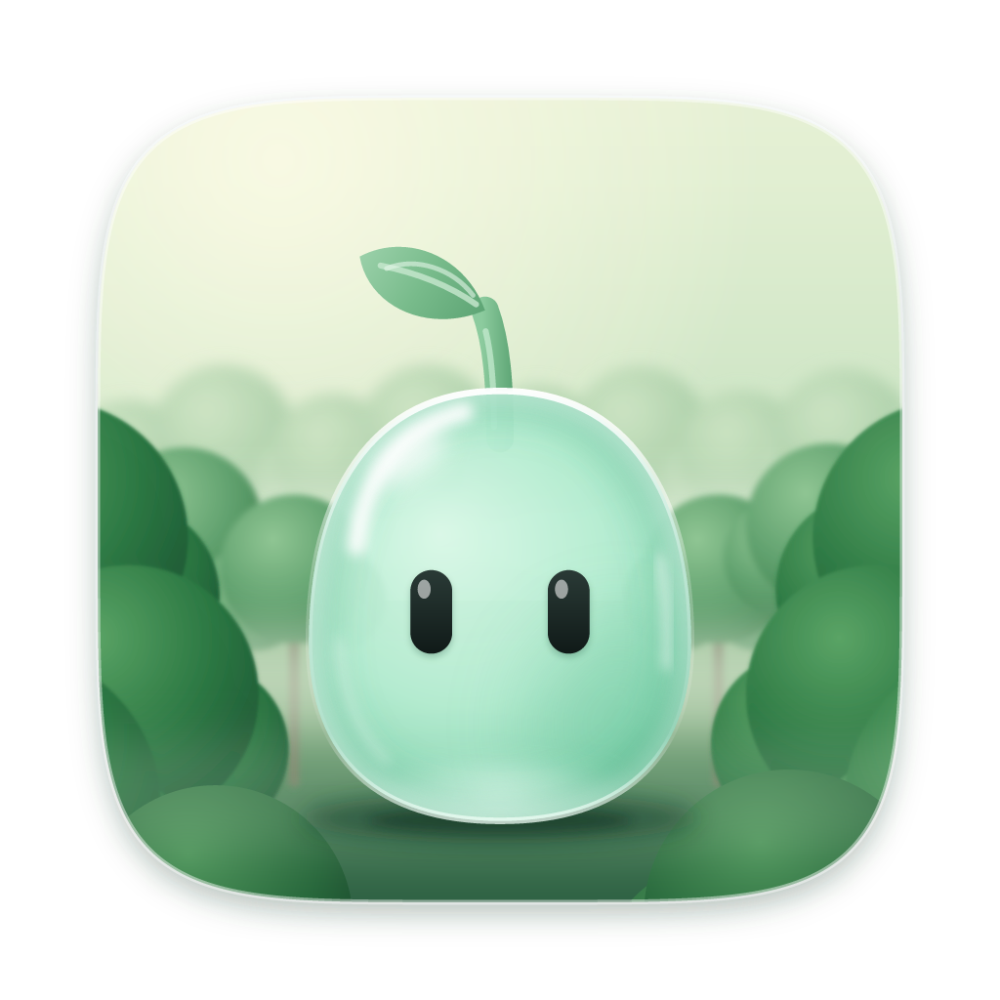
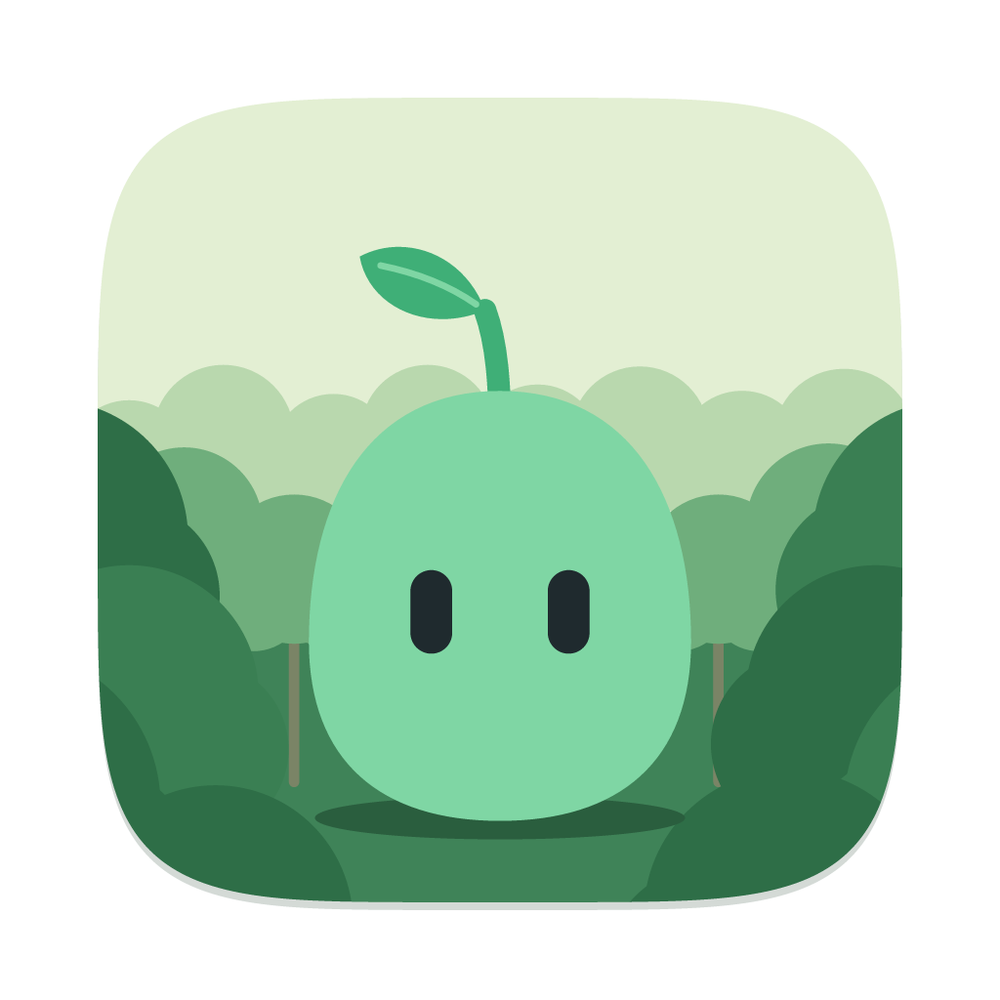

# Hain app icon (T-088, motif "Pim im Wald" since T-102)

Status: **in the app** (launcher icon, adaptive + themed, two looks the user can pick), on the website and in the README.

| 3D (default) | Flat |
|---|---|
|  |  |

## What it shows

**Motif: "Pim im Wald"** — chosen by Oskar on 04.11.2026 (T-102; reference picture `wald-pim-1`). Pim in his app shape from `assets/mascot/v2/static/pim_idle.svg` (round gummy-sweet body, two dark capsule eyes, stem with leaf fixed to the head) stands in front of a soft forest of round trees. No speech bubble, no text.

### 3D look (default, `ic_launcher`)

- **Pim:** glossy, slightly see-through mint glass. Radial mint gradient (almost white → `#B4EDD2` → `#6CC69E`), a greener, thicker glass edge, white inner glow, a long specular streak top left plus small side highlights, a light rim, a bounce light at the bottom and a soft contact shadow on the ground. Eyes dark with a tiny catch-light. Stem and leaf in matte sage green.
- **Forest:** three layers of round trees (each tree = one big ball + two shoulders, every ball with its own radial gradient, light from the upper left). Back layer light and blurred (misty), middle layer with thin trunks, front layer dark and big at the left and right edges, dark bushes in the bottom corners. Mist bands between the layers.
- **Sky:** light, greenish-cream gradient (`#F1F4DC` → `#C8E2C2`) with a soft warm glow top left.

### Flat look (`ic_launcher_flat`)

Same scene and layout, solid colours only — no gradients, no blur, no gloss. Pim as in `pim_idle.svg` (`#7FD6A4`, eyes `#1F2A2E`, leaf `#3FAF77`), trees in four greens (`#B9D8AE`, `#6FAE7C`, `#3A7F53`, `#2E6E47`), plain sky `#E3EFD3`, flat ground shadow.

Both checked at 1024, 96 and 48 px, masked round and squircle (adaptive crop); Pim stays inside the 66 dp safe zone.

**Debug build:** both looks with a small dark pill “dev” at the lower right (inside the safe zone), so the debug app (`app.hain.debug`) is easy to tell apart.

## Choosing the icon in the app (T-103)

Settings → Appearance → "App icon" and a row in the onboarding (after the language step). Two `activity-alias` entries in the manifest (`.Launcher3D` enabled, `.LauncherFlat` disabled) point to `MainActivity`; switching enables one and disables the other with `PackageManager.setComponentEnabledSetting(…, DONT_KILL_APP)`. The choice is stored in DataStore (`app_icon`, default 3D). The launcher may need a few seconds to show the new icon.

## Source

`assets/icon/src/make_icon.py` builds everything from one SVG description per look (pure vector, gradients + Gaussian blur for 3D, rendered with resvg). Pim's body, eyes, stem and leaf are 1:1 from `pim_idle.svg`. The scene is drawn in tile units (0..1024); the adaptive layers use a wider viewBox (108 dp layer, the launcher shows the inner 72 dp).

```bash
pip install resvg-py pillow
python3 assets/icon/src/make_icon.py          # assets/icon + app/src/main/res + app/src/debug/res
python3 assets/icon/src/make_icon.py --no-res # only assets/icon
```

Own work, no image model and no third-party artwork. SVGs in `assets/icon/src/`: `hain-icon.svg` (full-bleed master), `hain-icon-macos.svg` (squircle), `hain-icon-dev.svg`, `hain-icon-flat.svg`, `hain-icon-flat-macos.svg`.

## Files (`assets/icon/`)

| File | Size | Use |
|---|---|---|
| `hain-icon-1024.png` | 1024², full-bleed square | Master; stores, F-Droid |
| `hain-icon-512.png` | 512², full-bleed | Play Store listing (Play masks it) |
| `hain-icon-rounded-1024.png` | 1024², squircle on transparent | Website, README, docs, social |
| `hain-icon-dev-1024.png` | 1024², squircle | Debug variant |
| `hain-icon-foreground.png` / `-background.png` | 1024² | Adaptive layers of the 3D icon |
| `hain-icon-flat-1024.png` / `-flat-rounded-1024.png` | 1024² | Flat look, full bleed / squircle |
| `hain-icon-flat-foreground.png` / `-flat-background.png` | 1024² | Adaptive layers of the flat icon |

## In the app (`app/src/main/res`, `app/src/debug/res`)

- `mipmap-anydpi-v26/ic_launcher.xml`, `ic_launcher_round.xml` (3D) and `ic_launcher_flat.xml`, `ic_launcher_flat_round.xml` (flat): adaptive icons with background, foreground and **monochrome** layer.
- `mipmap-{m,h,xh,xxh,xxxh}dpi/`: `<name>_foreground.webp`, `<name>_background.webp` (108 dp layers) and the legacy `<name>.webp` (squircle) / `<name>_round.webp`.
- `drawable/ic_launcher_monochrome.xml`: themed icon (Android 13+), shared by both looks: Pim silhouette (body + stem + leaf) with the eyes cut out, vector.
- The debug source set only overrides the mipmaps (with the “dev” pill); the monochrome layer comes from `main`.

Website copies (`website/public/`): `img/hain-icon.webp` (rounded, 256 px), `favicon.png` (rounded, 64 px), `apple-touch-icon.png` (full-bleed, 180 px), `og.png` (rounded icon at 420 px, placed at 700/105). Update them whenever the icon changes.

## History

- 04.11.2026 (T-102): "Pim im Wald", 3D (default) and flat look, selectable in the app (T-103). Oskar's choice.
- 04.11.2026 (T-100i): "Pim als Sprechblase".
- 03.11.2026 (T-088): glossy glass Pim as a mint drop (Pim v2.1 shape) on a green squircle.
- 02.11.2026: 3D icon from an image model, never built into the app.
